# Carbon-Aware Scheduler

**Run flexible jobs when Britain's electricity is at its cleanest, and measure how much CO₂ that saves.**


<p align="center">
  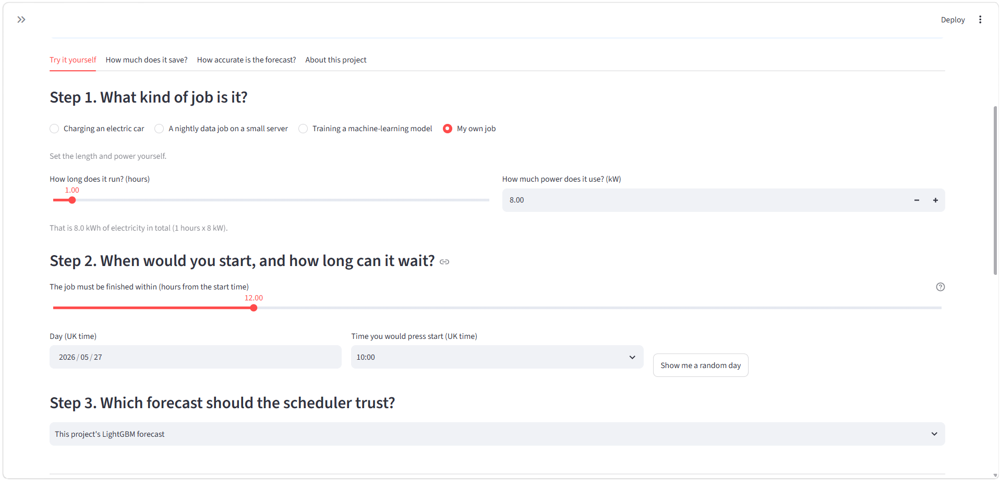
</p>

Great Britain's electricity does not carry the same amount of CO₂ all day. A windy night can be very clean, and a calm evening can be much dirtier. A lot of jobs do not need to start right now: charging an electric car, a nightly data job, training a model. If they can wait a few hours, they can wait for a cleaner moment.

I built this project to find out **how much CO₂ that would really save**, using real grid and weather data and a proper test on months of data the model had never seen.

## The short version

- I forecast Britain's carbon intensity 6 to 48 hours ahead with LightGBM, using public grid and weather data.
- A scheduler uses the forecast to pick the cleanest start time for a job within the time it is allowed to wait.
- I replayed about 730 past decisions for each setting over six months of unseen data (25 April to 25 October 2026) and measured the CO₂ using what actually happened.
- With a 24-hour window, scheduling with my forecast cut the CO₂ of a 4-hour car charge by **33.4%** compared with starting straight away. Perfect hindsight would have cut it by 37.1%.
- Across all three example jobs and all window lengths, the LightGBM schedules captured **between 86% and 91%** of the best possible saving.
- The grid operator's own forecast is more accurate than my model (about half the error). The scheduling results are close anyway, and the gap is covered in detail below.

## Results at a glance

CO₂ for one run of each job, with a 24-hour window, averaged over about 730 replayed decisions:

| Example job | Starting straight away | Scheduled with my LightGBM forecast | CO₂ saved | Best possible (perfect hindsight) | Share of best possible saving |
|---|---|---|---|---|---|
| Electric car charge (4 h, 7 kW) | 3.31 kg | 2.21 kg | **33.4%** | 37.1% | 90.0% |
| Nightly data job (2 h, 5 kW) | 1.20 kg | 0.76 kg | **36.4%** | 41.1% | 88.4% |
| Model training (6 h, 20 kW) | 14.30 kg | 10.10 kg | **29.4%** | 32.8% | 89.5% |

The three jobs are illustrative workloads, not measurements from real equipment. The longer a job can wait, the more it saves:

<p align="center">
  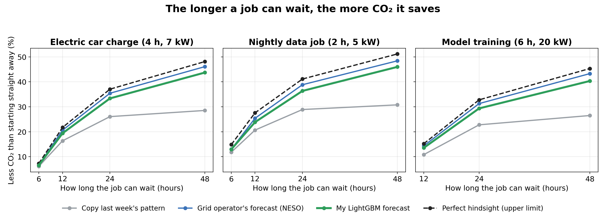
</p>

## Contents

1. [The problem](#the-problem)
2. [How the project works](#how-the-project-works)
3. [Data](#data)
4. [Understanding the data](#understanding-the-data)
5. [Forecasting](#forecasting)
6. [Scheduling](#scheduling)
7. [Backtest results](#backtest-results)
8. [The dashboard](#the-dashboard)
9. [Run it yourself](#run-it-yourself)
10. [Repository layout](#repository-layout)
11. [Design choices](#design-choices)
12. [Limitations](#limitations)
13. [Collaboration and private data](#collaboration-and-private-data)
14. [Data licences and attribution](#data-licences-and-attribution)

## The problem

Carbon intensity is the amount of CO₂ released to produce one unit of electricity, measured in grams of CO₂ per kilowatt-hour (g/kWh). It changes every half-hour, depending on how much power comes from wind, solar, nuclear, gas, biomass, hydro and imports.

If a job uses `E` kWh of electricity, the CO₂ it causes is roughly `E × the carbon intensity while it runs`. A 4-hour car charge at 7 kW uses 28 kWh. At 200 g/kWh that is 5.6 kg of CO₂. At 50 g/kWh it is 1.4 kg. The electricity used is identical. Only the timing changed.

The question this project answers: **if a job can start at any time inside an allowed window, when should it run, and how much CO₂ does that save compared with starting immediately?**

## How the project works

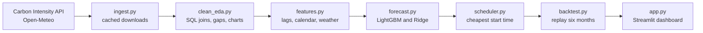

| Step | Script | What it does |
|---|---|---|
| 1 | `ingest.py` | Downloads intensity, generation mix and weather in chunks. Each chunk is cached, so a stopped run can resume. |
| 2 | `clean_eda.py` | Joins the tables with SQL, puts them on a complete half-hourly clock, handles gaps and bad values, writes a data-quality report and charts. |
| 3 | `features.py` | Builds the model inputs, making sure no feature uses information from the future. |
| 4 | `forecast.py` | Trains Ridge and LightGBM for four horizons and compares them with three benchmarks. |
| 5 | `scheduler.py` | Finds the lowest-CO₂ start time for a job. Can schedule several jobs under a power limit. |
| 6 | `backtest.py` | Replays past decisions and measures the real CO₂ using actual intensity. |
| 7 | `app.py` | Dashboard for exploring everything without reading any code. |

## Data

| Source | What I use | Link |
|---|---|---|
| Carbon Intensity API (National Energy System Operator, NESO) | Half-hourly carbon intensity for Great Britain (the official forecast and the actual value) and the generation mix by fuel | https://carbonintensity.org.uk |
| Open-Meteo Historical Weather API | Hourly wind speed at 100 m, sunshine, temperature and cloud cover at four points: Scotland, the North Sea, Wales and southern England | https://open-meteo.com |
| `holidays` Python package | England bank holidays | https://pypi.org/project/holidays |

By default the pipeline downloads from 1 January 2023 up to the day it is run. The results in this README come from one run, with a test period of 24 April to 24 October 2026 (8,831 half-hours).

## Understanding the data

Every row is one half-hour, in UTC. This is the cleaned table (`data/processed/clean.parquet`):

| Column | Meaning | Unit |
|---|---|---|
| `actual` | The real carbon intensity. **This is what the models try to predict.** | g CO₂ per kWh |
| `forecast` | The official forecast from the data provider. Used as a benchmark, never as a model input. | g CO₂ per kWh |
| `idx` | The provider's label for the level: very low, low, moderate, high or very high | text |
| `gen_wind`, `gen_solar`, `gen_gas`, `gen_nuclear`, `gen_hydro`, `gen_biomass`, `gen_coal`, `gen_imports`, `gen_other` | Share of electricity generated from each source in that half-hour | % |
| `wind_mean`, `wind_scotland`, `wind_north_sea` | Wind speed at 100 m: average of the four points, and two individual points | m/s |
| `solar_south`, `solar_mean` | Sunshine strength (shortwave radiation) in southern England and averaged over the four points | W/m² |
| `temp_mean` | Average temperature over the four points | °C |
| `cloud_mean` | Average cloud cover over the four points | % |
| `spike_flag` | 1 if the value looked unusual compared with its neighbours (kept, not deleted) | 0 or 1 |
| `actual_imputed` | 1 if a short gap was filled by interpolation | 0 or 1 |
| `official_error` | `forecast - actual` | g CO₂ per kWh |

The modelling table (`data/processed/features.parquet`) adds the inputs the models learn from. The exact list is saved in `data/processed/feature_list.json`.

| Group | Examples | Why |
|---|---|---|
| Past intensity | the value 2, 3, 7 and 14 days ago; rolling averages, spread, minimum and maximum | Grid patterns repeat daily and weekly |
| Calendar | half-hour of day, weekday, month, weekend, bank holiday, day before and after a holiday, sine and cosine of time of day and year | Demand follows human routines |
| Weather | wind speeds, wind speed cubed, 6-hour average wind, 3-hour wind change, sunshine, temperature, cloud | Wind and sun decide how much renewable power there is. Wind power rises with the cube of wind speed. |
| Past generation mix | each fuel's share and the combined renewable share, as old as the forecast horizon (48 hours for the main model) | Shows what the grid looked like recently |

Some views of the data:

<table>
  <tr>
    <td>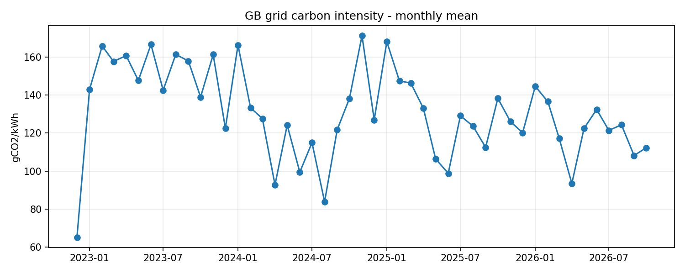</td>
    <td>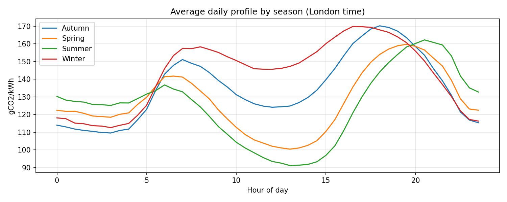</td>
  </tr>
  <tr>
    <td align="center">Average carbon intensity by month</td>
    <td align="center">Average day, split by season (London time)</td>
  </tr>
  <tr>
    <td>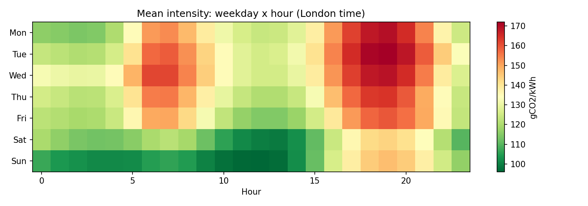</td>
    <td>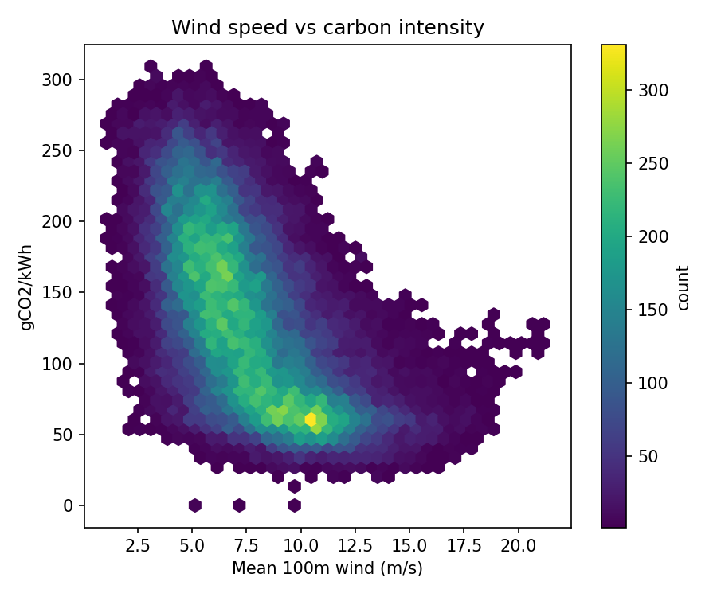</td>
  </tr>
  <tr>
    <td align="center">Average intensity by weekday and hour</td>
    <td align="center">Wind speed against carbon intensity</td>
  </tr>
  <tr>
    <td>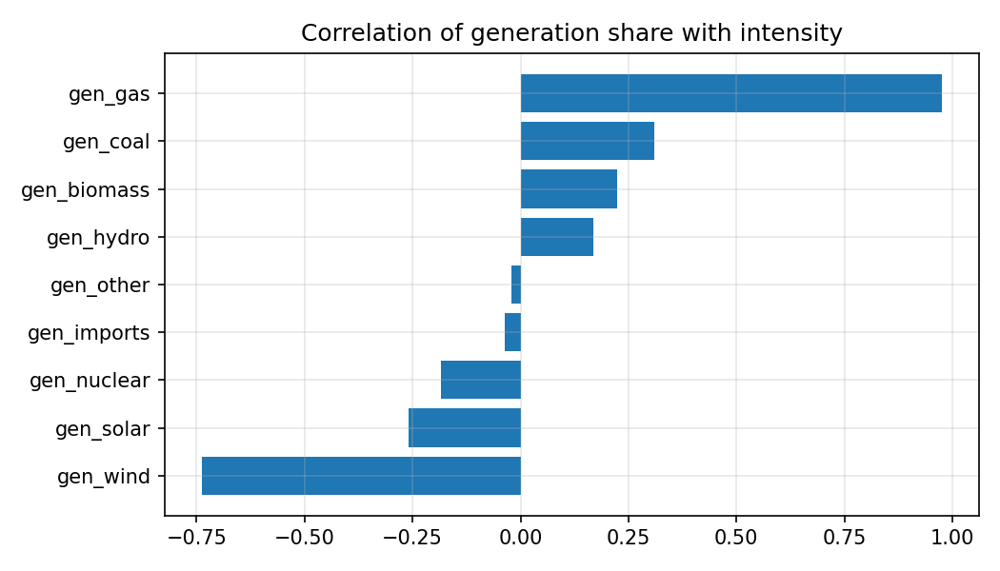</td>
    <td>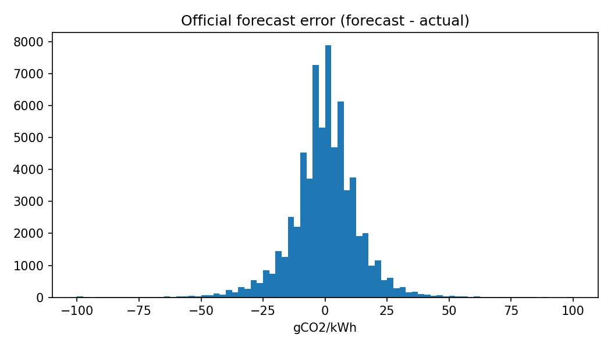</td>
  </tr>
  <tr>
    <td align="center">How each fuel's share moves with intensity</td>
    <td align="center">Errors of the official forecast</td>
  </tr>
</table>

## Forecasting

I trained one model for each forecast horizon (6, 12, 24 and 48 hours ahead). Each horizon gets its own feature table, because the further ahead you forecast, the older the latest usable value is.

**Models**

- **LightGBM** is the main model. It builds many small decision trees one after another, and each new tree corrects the mistakes of the ones before it. It is quick, works well on tables of numbers like this one, and can pick up interactions such as "very windy and night-time". Settings: learning rate 0.03, up to 3,000 trees, 31 leaves per tree, 80% row and column sampling, seed 42. Training stops early when the validation error has not improved for 100 rounds.
- **Ridge regression** is a simple linear model. It is there as a check: if LightGBM could not beat it, the extra complexity would not be worth it.

**Benchmarks, which are not models I trained**

- The **official forecast** published by the data provider (NESO)
- **Same time yesterday**
- **Same time last week**

**How the data is split.** Chronologically, never randomly. The most recent six months (24 April to 24 October 2026) are the test set and are never used for training or tuning. The three months before that are used to decide when LightGBM should stop training. Everything older is training data.

**No peeking at the future.** A forecast is made at some moment for a time up to H hours later. Any feature built from past intensity or generation is therefore at least H hours old. The 48-hour model uses the value from 48 hours ago and earlier, never the value from 30 minutes ago. This is checked in the code and in the tests.

### Forecast accuracy on the test set

The score is the **average absolute error (MAE)** in g CO₂ per kWh. Lower is better.

| Model | 6 h ahead | 12 h ahead | 24 h ahead | 48 h ahead |
|---|---|---|---|---|
| **LightGBM** | **18.49** | **21.06** | **19.77** | **21.51** |
| Ridge regression | 19.58 | 23.11 | 21.66 | 24.19 |
| Official forecast (NESO) | 10.78 | 10.78 | 10.78 | 10.78 |
| Same time yesterday | 37.14 | 37.14 | 37.14 | not available |
| Same time last week | 46.24 | 46.24 | 46.24 | 46.24 |

More detail for LightGBM:

| Horizon | MAE | RMSE | Bias (positive means it predicts too high) |
|---|---|---|---|
| 6 hours | 18.49 | 23.44 | +5.06 |
| 12 hours | 21.06 | 26.36 | +7.03 |
| 24 hours | 19.77 | 25.01 | +7.24 |
| 48 hours | 21.51 | 27.28 | +5.73 |

What this shows:

- LightGBM roughly halves the error of the "same time" guesses (about 47% lower than yesterday's pattern and 57% lower than last week's, at 24 hours) and beats Ridge at every horizon by 5% to 11%.
- **The official forecast is clearly better**: its error is roughly half of mine. It is built by NESO with its own modelling and system data, which I do not have. I also do not know how far ahead each stored official forecast was issued, so this comparison may not be like for like.
- The official forecast and the two "same time" guesses do not change with the horizon, so their numbers repeat. "Same time yesterday" cannot be used at 48 hours ahead.
- My model's error barely grows from 6 to 48 hours. That is because it is given **the weather that actually happened**, not a weather forecast. In real use, longer horizons would be less accurate.
- The model leans a little high (+5 to +7 g/kWh on average). I have not investigated why.

<table>
  <tr>
    <td>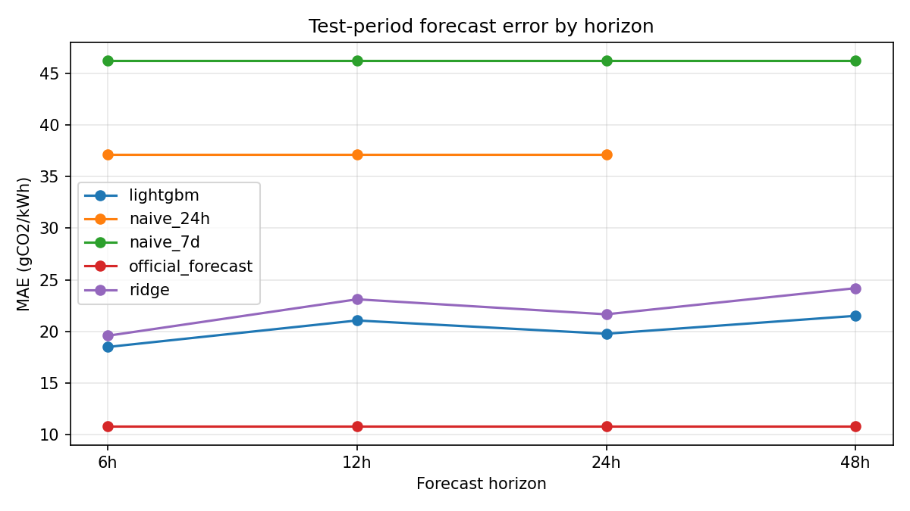</td>
    <td>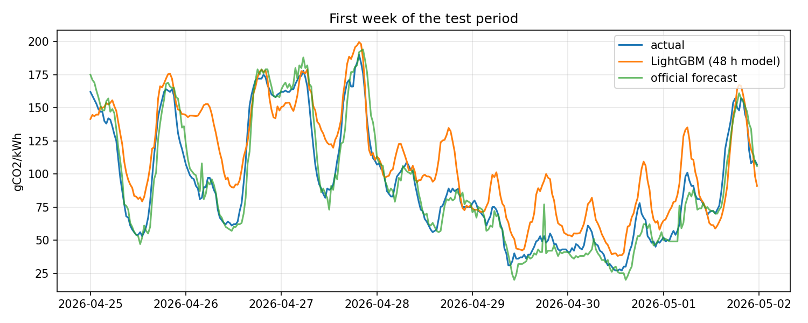</td>
  </tr>
  <tr>
    <td align="center">Error by horizon</td>
    <td align="center">First week of the test period</td>
  </tr>
</table>

<p align="center">
  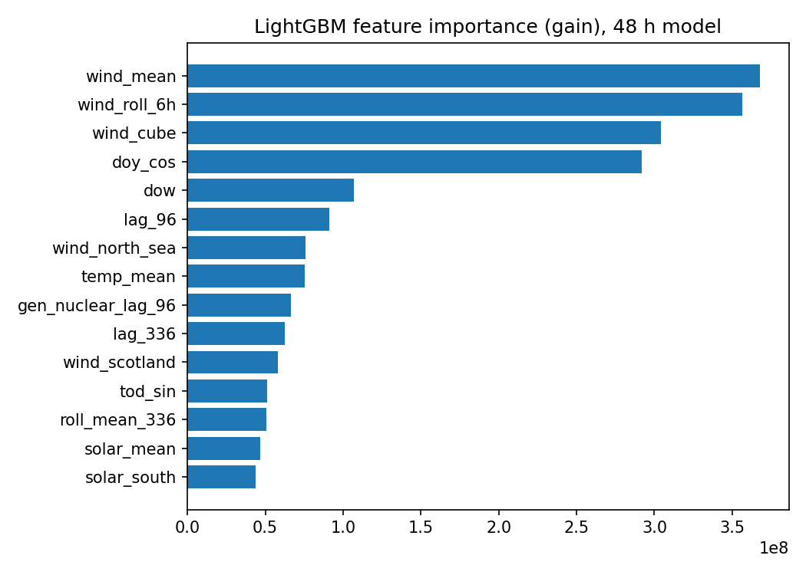<br>
  The inputs the 48-hour LightGBM model relied on most
</p>

## Scheduling

A job has a length, a power draw and a window: the earliest it can start and the time it must be finished by. It runs in one go, without pauses.

```
CO₂ in kg = power (kW) × 0.5 hours × (sum of the intensities over the job's half-hours) / 1000
```

`scheduler.py` works this out for every possible start time inside the window, using running totals so it is quick, and picks the cheapest one. It is called with a **forecast** to make the decision, and the result is then judged with the **actual** intensity.

For several jobs at once with a limit on how much power the site can use at one time, it solves a small optimisation problem (one yes/no variable per job and start time) using SciPy's `milp` solver.

## Backtest results

To avoid judging the idea on one lucky day, I replayed the decision **at 00:00, 06:00, 12:00 and 18:00 UTC on every day of the test period**, giving about 730 decisions per setting. Each time:

1. The scheduler only used forecasts that existed at that moment.
2. It chose a start time.
3. The CO₂ was calculated from the intensity that really followed.

Decision points whose window contained missing data were skipped.

**Ways of choosing the start time that I compared**

| Strategy | Meaning |
|---|---|
| Immediate | Start right away. This is the baseline. |
| Random start in the window | The average result of picking any time in the window without a forecast. A fair "no cleverness" check. |
| Last week's pattern | Schedule as if this week looks like last week |
| Official forecast (NESO) | Schedule using the data provider's forecast |
| **LightGBM** | Schedule using my forecast |
| Perfect hindsight | Schedule using the real values. Not possible in real life, so it is the ceiling. |

Starting immediately and starting at a random time give almost the same CO₂ (within about 1.3% of each other), so the savings below are not an artefact of the four decision times I picked.

### CO₂ saved compared with starting straight away

**Electric car charge (4 hours, 7 kW)**

| Window the job can wait | 6 h | 12 h | 24 h | 48 h |
|---|---|---|---|---|
| Last week's pattern | 6.1% | 16.4% | 26.1% | 28.5% |
| Official forecast (NESO) | 6.6% | 20.6% | 35.4% | 46.1% |
| **LightGBM** | **6.6%** | **19.4%** | **33.4%** | **43.7%** |
| Perfect hindsight | 7.3% | 21.7% | 37.1% | 48.1% |

**Nightly data job (2 hours, 5 kW)**

| Window the job can wait | 6 h | 12 h | 24 h | 48 h |
|---|---|---|---|---|
| Last week's pattern | 11.8% | 20.7% | 28.9% | 30.8% |
| Official forecast (NESO) | 13.0% | 25.4% | 38.8% | 48.4% |
| **LightGBM** | **13.0%** | **23.8%** | **36.4%** | **46.0%** |
| Perfect hindsight | 14.9% | 27.6% | 41.1% | 51.2% |

**Model training (6 hours, 20 kW)**

| Window the job can wait | 12 h | 24 h | 48 h |
|---|---|---|---|
| Last week's pattern | 10.8% | 22.8% | 26.5% |
| Official forecast (NESO) | 14.4% | 31.3% | 43.3% |
| **LightGBM** | **13.6%** | **29.4%** | **40.3%** |
| Perfect hindsight | 15.2% | 32.8% | 45.3% |

(A 6-hour job cannot be moved inside a 6-hour window, so there is no result for that case.)

### How much of the best possible saving was captured

| Job | Forecast used | 6 h | 12 h | 24 h | 48 h |
|---|---|---|---|---|---|
| Car charge | LightGBM | 90.2% | 89.2% | 90.0% | 90.5% |
| Car charge | Official (NESO) | 91.2% | 94.8% | 95.6% | 95.8% |
| Nightly data job | LightGBM | 87.2% | 86.5% | 88.4% | 89.9% |
| Nightly data job | Official (NESO) | 87.4% | 92.1% | 94.4% | 94.6% |
| Model training | LightGBM | n/a | 89.1% | 89.5% | 89.0% |
| Model training | Official (NESO) | n/a | 94.4% | 95.4% | 95.5% |

How I read these results:

- **LightGBM captures roughly 87% to 92% of the best possible saving in every setting.** It is not a result that depends on one job or one window.
- **The gap to the official forecast in scheduling is small**: between about 0.8 and 2.3 percentage points of saving at 12 hours and beyond, and under 0.1 at 6 hours. Scheduling only needs to rank the half-hours inside the window correctly. It does not need to predict each value exactly.
- That is also why even "last week's pattern", with an average error of 46 g/kWh, still captures a good share of the saving.
- Longer windows save more, because there are more chances to catch a windy or sunny spell.

The full tables, including kilograms of CO₂ for every strategy, are in [`reports/results.md`](reports/results.md) and [`reports/backtest_summary.csv`](reports/backtest_summary.csv).

## The dashboard

The Streamlit dashboard is written for people who have never seen the project. It explains itself on the page, uses plain language, and has four tabs:

| Tab | What you can do |
|---|---|
| **Try it yourself** | Pick a job (car charge, data job, model training or your own), a day and a deadline. See when the scheduler would start it, and how much CO₂ that avoids compared with starting straight away. A "Show me a random day" button makes it easy to explore. |
| **How much does it save?** | Choose a job and how long it can wait to see the average saving over hundreds of replayed decisions, for each way of choosing the start time. |
| **How accurate is the forecast?** | Compare the models at each horizon, with a plain explanation of the score. |
| **About this project** | Data sources, the method in five steps, and the limitations. |

<p align="center">
  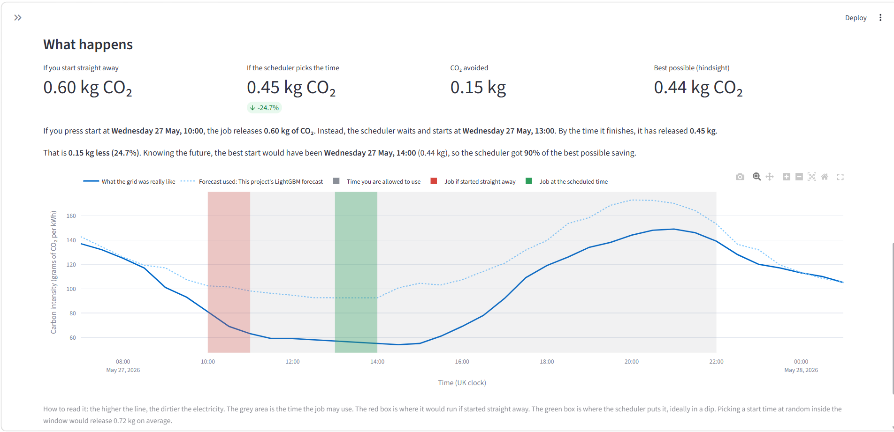
</p>

Everything in the dashboard is a **replay of past data**. It is not a live service and does not control any device.

## Run it yourself

### Just the dashboard (about two minutes)

The files the dashboard needs are included in the repository, so there is no download step. Clone or download the repository, open a terminal in its folder and run:

```bash
python -m venv .venv
source .venv/bin/activate          # Windows PowerShell: .venv\Scripts\activate
pip install -r requirements.txt
streamlit run app.py
```

### Rebuild everything from the raw data

```bash
python ingest.py        # downloads from 2023-01-01 to today; several minutes the first time, then cached
python clean_eda.py
python features.py
python forecast.py
python backtest.py
streamlit run app.py
```

Run the scripts one after another and wait for each to finish. `ingest.py` takes `--start YYYY-MM-DD`, `--end YYYY-MM-DD` and `--skip-weather`. If it stops halfway, run it again and it carries on from the cached chunks.

If you rebuild later, the data will include newer days and the test period will move forward, so your numbers will differ somewhat from the ones above.

### Tests

```bash
pip install -r requirements-dev.txt
python -m pytest
```

The 14 tests cover gap filling, duplicate and bad-value handling, the leakage checks, the scheduler (including the power-limit case), the backtest and the train/validation/test split. They run on small in-memory data and need no internet. The same tests run on every push through GitHub Actions.

## Repository layout

```
.
├── app.py                  # Streamlit dashboard
├── backtest.py             # replays past decisions
├── clean_eda.py            # cleaning, data-quality report, charts
├── common.py               # paths, settings, SQLite helpers
├── features.py             # model inputs, no-peeking checks, time split
├── forecast.py             # Ridge and LightGBM, accuracy by horizon
├── ingest.py               # cached downloads from the two APIs
├── scheduler.py            # cheapest start time for one or many jobs
├── tests/                  # unit tests
├── reports/                # results.md, CSV metrics, data-quality report, figures/
├── data/processed/         # predictions_48h.parquet (kept so the dashboard runs straight away)
├── .github/workflows/      # runs the tests on every push
├── Makefile                # shortcuts (needs make; on Windows run the scripts directly)
├── requirements.txt
└── requirements-dev.txt
```

The rest of `data/` (raw downloads, the SQLite database, intermediate tables) and `models/` are rebuilt by the scripts and are not in the repository.

## Design choices

- **Cached, windowed downloads.** The API only gives about 14 days per request, so history is fetched in 13-day chunks and every chunk is saved. A stopped run does not start again from zero.
- **Everything in UTC.** Daylight-saving changes create duplicate and missing local times. London time is only used for patterns people care about (time of day, bank holidays) and for the charts.
- **Short gaps filled, long gaps left alone.** Gaps of up to two hours are interpolated. Anything longer stays empty, because inventing hours of data would hide real problems.
- **Spikes flagged, not deleted.** Real grid events do happen.
- **A time-based split.** Random splitting lets a model learn from the future and makes results look better than they are.
- **A benchmark I could not beat.** I kept the official forecast in the comparison on purpose. A model that only compares itself with weak baselines tells you very little.
- **One model per horizon.** It makes the accuracy-versus-distance trade-off visible instead of hiding it.

## Limitations

I would rather be upfront about these than have anyone find them later.

- **Observed weather replaces weather forecasts.** The model sees the weather that actually happened, so its accuracy would be lower in live use, especially for longer horizons. This is the biggest caveat on the forecast numbers.
- **The official forecast is more accurate.** Its error is roughly half of mine, and I do not know its exact lead time, so the comparison may not be like for like.
- **The test period is six months (April to October).** Winter, when demand and wind patterns differ, is not in the results. The results are one run with no confidence intervals.
- **Average intensity, not marginal.** The data reports the average intensity of the grid. The CO₂ actually caused by one extra job may differ.
- **The jobs are illustrative.** Their length and power draw are typical values I chose, not measurements. Real jobs are often interruptible or have other constraints.
- **Replay, not a live system.** Nothing here runs in real time or controls a device. A live version would need a weather forecast feed and a way to send start times to real equipment.
- **National level only.** The data is for Great Britain as a whole, with four fixed weather points standing in for where wind and solar power is generated.
- **Unexplained bias.** The model predicts slightly too high on average (+5 to +7 g/kWh). I have not yet found out why.
- **The newest days are excluded** from the modelling table because the weather archive lags real time by several days.

## Collaboration and private data

Everything here uses public data and illustrative jobs. The most useful next step is testing it on **real workloads**, and I would like to work with anyone who has relevant data they could share. For example:

- half-hourly electricity use from buildings or sites
- EV charging session logs
- compute job logs: when jobs start, how long they run, how much power they use, and how much slack they really have
- information about real limits, such as site power caps or deadlines

Real data like this would let me replace the three illustrative jobs with real ones, learn which jobs can actually move, and see how much saving is realistic. Private data would stay private. It would be handled under whatever agreement is needed, and none of it would go in this public repository.

If you would like to talk, please open an issue on this repository or message me on GitHub or LinkedIn.

## Data licences and attribution

- Carbon intensity and generation data: Carbon Intensity API, National Energy System Operator (NESO), licensed [CC BY 4.0](https://creativecommons.org/licenses/by/4.0/). https://carbonintensity.org.uk
- Weather data: [Open-Meteo.com](https://open-meteo.com/), licensed CC BY 4.0. The free Open-Meteo API is for non-commercial use, so any commercial use of this pipeline would need an Open-Meteo plan.
- `data/processed/predictions_48h.parquet` contains values derived from the NESO data (actual intensity and the official forecast) alongside this project's own predictions, shared under the same attribution.

This project is not affiliated with or endorsed by NESO or Open-Meteo.
